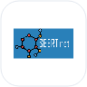

<table>
<tr>

<td width="34%" align="center" valign="middle">

</td>

<td width="66%" valign="middle">

### Hi, I'm 👋

# Pallavi Vholgade

### B.E. AIML Graduate

**Data Science · Data Analytics · AI/ML · Machine Learning · GenAI · Python**

I turn data into intelligence and ideas into practical systems.

</td>
</tr>
</table>

**Explore:** [About me](#about-me) · [Technology toolkit](#technology-toolkit) · [Featured projects](#featured-work) · [Full portfolio](https://pallavi-portfolio-preview.vercel.app)

---

## ♡ About Me

<table>
<tr>
<td width="72%" valign="top">

I build intelligent systems from data — from **analysis and prediction to AI-powered applications**.

My work spans **data cleaning, exploratory analysis, machine learning, NLP, Generative AI, agentic workflows, Python backend development, and mobile AI applications**.

I enjoy turning real-world problems into practical, understandable, and useful products.

</td>
<td width="28%" valign="top">

**✦ Problem Solver**  
**✦ Quick Learner**  
**✦ Detail Oriented**  
**✦ Practical Builder**

</td>
</tr>
</table>

---

## </> Tech Stack

Click a logo to open its documentation. Expand or collapse a group to explore the tools. Brand marks keep their original colours; general AI concepts use consistent technical symbols.

<strong>Application Development</strong> &middot; 11 tools

<table>
<tr>
<td align="center" width="110"><a href="https://docs.python.org/3/" title="Python documentation"> <b>Python</b></a></td>
<td align="center" width="110"><a href="https://docs.djangoproject.com/" title="Django documentation"> <b>Django</b></a></td>
<td align="center" width="110"><a href="https://fastapi.tiangolo.com/" title="FastAPI documentation"> <b>FastAPI</b></a></td>
<td align="center" width="110"><a href="https://react.dev/" title="React documentation"> <b>React</b></a></td>
<td align="center" width="110"><a href="https://docs.flutter.dev/" title="Flutter documentation"> <b>Flutter</b></a></td>
</tr>
<tr>
<td align="center" width="110"><a href="https://dart.dev/" title="Dart documentation"> <b>Dart</b></a></td>
<td align="center" width="110"><a href="https://developer.mozilla.org/en-US/docs/Glossary/SQL" title="SQL documentation"> <b>SQL</b></a></td>
<td align="center" width="110"><a href="https://git-scm.com/doc" title="Git documentation"> <b>Git</b></a></td>
<td align="center" width="110"><a href="https://dev.java/learn/" title="Java documentation"> <b>Java</b></a></td>
<td align="center" width="110"><a href="https://developer.mozilla.org/en-US/docs/Web/HTML" title="HTML documentation"> <b>HTML</b></a></td>
</tr>
<tr>
<td align="center" width="110"><a href="https://developer.mozilla.org/en-US/docs/Web/CSS" title="CSS documentation"> <b>CSS</b></a></td>
</tr>
</table>

<strong>Data &amp; Machine Learning</strong> &middot; 9 tools

<table>
<tr>
<td align="center" width="110"><a href="https://pandas.pydata.org/docs/" title="Pandas documentation"> <b>Pandas</b></a></td>
<td align="center" width="110"><a href="https://numpy.org/doc/" title="NumPy documentation"> <b>NumPy</b></a></td>
<td align="center" width="110"><a href="https://scikit-learn.org/stable/" title="Scikit-learn documentation"> <b>Scikit-learn</b></a></td>
<td align="center" width="110"><a href="https://www.tensorflow.org/lite" title="TensorFlow Lite documentation"> <b>TensorFlow Lite</b></a></td>
<td align="center" width="110"><a href="https://developers.google.com/ml-kit" title="Google ML Kit documentation"> <b>Google ML Kit</b></a></td>
</tr>
<tr>
<td align="center" width="110"><a href="https://docs.opencv.org/" title="OpenCV documentation"> <b>OpenCV</b></a></td>
<td align="center" width="110"><a href="https://ai.google.dev/edge/mediapipe" title="MediaPipe documentation"> <b>MediaPipe</b></a></td>
<td align="center" width="110"><a href="https://huggingface.co/learn/nlp-course/" title="NLP documentation"> <b>NLP</b></a></td>
<td align="center" width="110"><a href="https://opencv.org/" title="Computer Vision documentation"> <b>Computer Vision</b></a></td>
</tr>
</table>

<strong>Generative AI</strong> &middot; 10 tools

<table>
<tr>
<td align="center" width="110"><a href="https://console.groq.com/docs" title="Groq documentation"> <b>Groq</b></a></td>
<td align="center" width="110"><a href="https://docs.ollama.com/" title="Ollama documentation"> <b>Ollama</b></a></td>
<td align="center" width="110"><a href="https://docs.streamlit.io/" title="Streamlit documentation"> <b>Streamlit</b></a></td>
<td align="center" width="110"><a href="https://www.sbert.net/" title="Sentence Transformers documentation"> <b>Sentence Transformers</b></a></td>
<td align="center" width="110"><a href="https://docs.langchain.com/oss/python/langchain/overview" title="LangChain documentation"> <b>LangChain</b></a></td>
</tr>
<tr>
<td align="center" width="110"><a href="https://docs.langchain.com/oss/python/langgraph/overview" title="LangGraph documentation"> <b>LangGraph</b></a></td>
<td align="center" width="110"><a href="https://huggingface.co/docs/transformers/" title="LLMs documentation"> <b>LLMs</b></a></td>
<td align="center" width="110"><a href="https://docs.langchain.com/oss/python/langchain/rag" title="RAG documentation"> <b>RAG</b></a></td>
<td align="center" width="110"><a href="https://docs.langchain.com/oss/python/langchain/agents" title="AI Agents documentation"> <b>AI Agents</b></a></td>
<td align="center" width="110"><a href="https://ai.google.dev/gemini-api/docs/prompting-strategies" title="Prompt Engineering documentation"> <b>Prompt Engineering</b></a></td>
</tr>
</table>

<strong>Tools &amp; Platforms</strong> &middot; 9 tools

<table>
<tr>
<td align="center" width="110"><a href="https://docs.github.com/" title="GitHub documentation"> <b>GitHub</b></a></td>
<td align="center" width="110"><a href="https://code.visualstudio.com/docs" title="VS Code documentation"> <b>VS Code</b></a></td>
<td align="center" width="110"><a href="https://docs.jupyter.org/" title="Jupyter Notebook documentation"> <b>Jupyter Notebook</b></a></td>
<td align="center" width="110"></td>
<td align="center" width="110"><a href="https://www.ibm.com/products/watsonx-ai" title="IBM watsonx.ai documentation"> <b>IBM watsonx.ai</b></a></td>
</tr>
<tr>
<td align="center" width="110"><a href="https://cloud.ibm.com/docs" title="IBM Cloud documentation"> <b>IBM Cloud</b></a></td>
<td align="center" width="110"><a href="https://docs.docker.com/" title="Docker documentation"> <b>Docker</b></a></td>
<td align="center" width="110"><a href="https://learning.postman.com/docs/" title="Postman documentation"> <b>Postman</b></a></td>
<td align="center" width="110"><a href="https://firebase.google.com/docs" title="Firebase documentation"> <b>Firebase</b></a></td>
</tr>
</table>

<strong>More tools I use</strong> &middot; 4 tools

<table>
<tr>
<td align="center" width="110"><a href="https://learn.microsoft.com/power-bi/" title="Power BI documentation"> <b>Power BI</b></a></td>
<td align="center" width="110"><a href="https://developer.android.com/" title="Android documentation"> <b>Android</b></a></td>
<td align="center" width="110"><a href="https://docs.pytest.org/" title="pytest documentation"> <b>pytest</b></a></td>
<td align="center" width="110"><a href="https://docs.github.com/actions" title="GitHub Actions documentation"> <b>GitHub Actions</b></a></td>
</tr>
</table>

---

## ☆ Featured Projects

<table>
<tr>

<td width="50%" valign="top">

### 🚗 DriverGuard AI

Real-time Android driver safety application that detects drowsiness and distraction using on-device computer vision and AI, with offline monitoring, voice warnings, and emergency SMS escalation.

`Flutter` `Dart` `TensorFlow Lite` `Google ML Kit` `Computer Vision` `Python`

**Key Features:** Eye-closure detection · Yawn detection · Head-pose monitoring · Offline on-device inference · Voice alerts · Emergency contacts · Automatic SMS alerts · Repeated SMS escalation

**[View Repository ↗](https://github.com/pallavivhalgade/AI-Based-Driver-Fatigue-and-Distraction-Detection)** · **[Android builds ↗](https://github.com/pallavivhalgade/AI-Based-Driver-Fatigue-and-Distraction-Detection/actions/workflows/android-release.yml)**

</td>

<td width="50%" valign="top">

### 🤖 Interview Prep Agent

AI-powered interview preparation application that analyzes resumes and job descriptions to generate role-specific questions, grounded answers, skill-gap insights, and personalized study plans.

`Python` `Streamlit` `Groq LLM` `Sentence Transformers` `Generative AI`

**Key Features:** Resume–JD matching · Skill-gap analysis · Role-specific interview questions · Grounded answers · AI question review · Personalized study plans

**[View Repository ↗](https://github.com/pallavivhalgade/interview-prep-agent)** · **[Live Demo ↗](https://interview-prep-agent-94gjmmzu9q3w9gp4by8uan.streamlit.app/)**

</td>

</tr>

<tr>

<td width="50%" valign="top">

### 🏥 SmartHealth Appointment System

Role-based healthcare appointment platform with secure scheduling, validation, authentication, and production deployment.

`Python` `Django` `SQLite` `Render`

**Key Features:** Role-based authentication · Doctor/Patient dashboards · Appointment booking · Edit/Cancel appointments · Database integration

**[View Repository ↗](https://github.com/pallavivhalgade/smart-health-appointment)** · **[Live Demo ↗](https://smart-health-appointment-pi.vercel.app)**

</td>

<td width="50%" valign="top">

### ✦ CareerPilot AI

A career preparation workspace for resume matching, interview practice, personalized seven-day plans, and contextual career coaching.

`React` `FastAPI` `Ollama` `LangChain` `LangGraph` `ChromaDB`

**Key Features:** Resume–JD matching · Skill-gap insights · Interview practice · Grounded preparation plans

**[View Repository ↗](https://github.com/pallavivhalgade/CareerPilotAI)** · **[Live Demo ↗](https://careerpilot-ai-three-virid.vercel.app)**

</td>

</tr>
</table>

---

<strong>More data and AI projects</strong>

| Project | Explore |
| --- | --- |
| Customer Behavior Analysis | [Python, SQL & Power BI](https://github.com/pallavivhalgade/customer-analysis-python-PowerBI) |
| Vendor Performance Analysis | [Inventory, profitability & supplier insights](https://github.com/pallavivhalgade/vendor-performance-analysis-sql-python-powerbi-) |
| LearnMate | [Personalized pathways with IBM watsonx](https://github.com/pallavivhalgade/learnmate-watsonx) |

### ✦ Building with data, models, and AI — one practical system at a time. 💜

